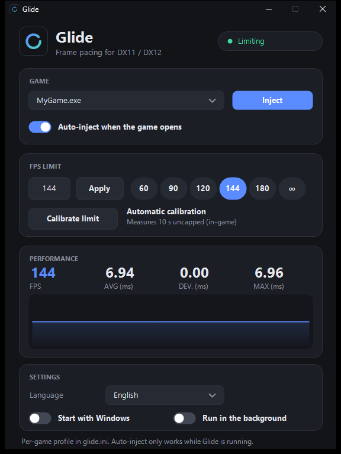
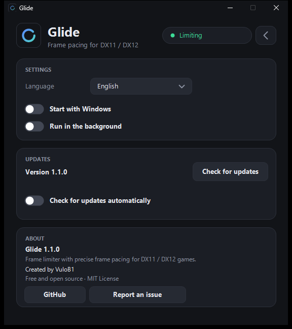

<div align="center">


# Glide

**A frame limiter with precise frame pacing for DX11, DX12, OpenGL and Vulkan games on Windows.**

Smooth, evenly spaced frames instead of stutter. Built for high-refresh-rate monitors.

[](https://github.com/VuloB1/glide/releases/latest)
[](LICENSE)




</div>

---

## Why Glide?

A plain FPS cap only controls the *average*. If frames are delivered at uneven moments, the game still feels choppy. Glide hooks `IDXGISwapChain::Present` and releases every frame on an exact deadline, so the time between frames stays flat. In testing, the frame-time deviation sits around **0.01 ms** (see the live graph above).

## Features

- **Precise frame pacing.** Each deadline is the previous one plus the interval, so there is no cumulative drift. It waits on a high-resolution timer, then finishes with a short spin for sub-millisecond accuracy.
- **DX11, DX12, OpenGL and Vulkan.** Hooks the shared swap chain `Present` / `Present1` for DirectX, `SwapBuffers` for OpenGL games such as Minecraft Java Edition (`javaw.exe`), and `vkQueuePresentKHR` for Vulkan. If a stack presents through two APIs for the same frame (DXVK), only one of them is limited.
- **Process picker.** Pick the game from a clean dropdown of running windowed processes. Launchers, browsers and system tools are filtered out.
- **Auto-inject.** Turn it on once per game and Glide attaches itself the next time the game starts (while the Glide window is open).
- **Per-game profiles.** Every game keeps its own FPS limit and settings in `glide.ini`.
- **Automatic limit suggestion.** Hit *Calibrate*: Glide runs the game uncapped for 10 seconds, measures your real frame times and suggests a limit your system can hold steadily.
- **Live performance graph.** FPS, average, deviation and max frame time, streamed straight from the game.
- **Six languages.** English, Español, Português, 日本語, 中文 and 한국어. Defaults to your Windows language and can be changed in the app.
- **Start with Windows and run in the background.** Optional autostart, and closing the window can keep Glide in the system tray so auto-inject keeps working.
- **Updates from GitHub.** Glide checks the latest release (once a day, can be turned off) and updates in one click. The installer is only run if its SHA-256 matches the digest GitHub publishes for the release.
- **Settings and About.** A gear button opens the settings page: language, autostart, background mode, updates, and info about the program and its creator.
- **Light on resources.** The spin-wait before each frame adapts to your machine's timer jitter (about half the CPU of a fixed margin at 177 FPS with the same precision), and the window repaints only what changed: ~2% of a core with the live graph, ~0% and ~3 MB when minimized or in the tray.
- **Installer included.** Per-user install, no admin rights needed, Start Menu and optional Desktop shortcuts, clean uninstall.

<div align="center">

</div>

## Anti-cheat protection

Glide injects a DLL into the game, which anti-cheat systems can treat as cheating. To protect your account, Glide **refuses to attach to games that use anti-cheat**:

- **A built-in blocklist** of 70+ known titles and launchers (Valorant, Overwatch, Fortnite, Apex Legends, CS2, Rainbow Six Siege, Escape from Tarkov, Genshin Impact, Zenless Zone Zero, Battlefield 6, Call of Duty, GTA V Online, Rust, and more).
- **Module scanning.** Before injecting, Glide checks the target process for anti-cheat modules (Easy Anti-Cheat, BattlEye, Vanguard, GameGuard, XIGNCODE3, FACEIT, Ricochet, and others) and aborts if it finds one.
- **Blocked games stay visible but dimmed**, tagged with a red *BLOCKED* label, and cannot be selected.
- **Your own entries.** Add any exe to the `[block]` section of `glide.ini` (`Name.exe=1`).

This applies to both manual and automatic injection.

> [!WARNING]
> The blocklist and module scan are safety nets, not guarantees. Anti-cheat software changes constantly and some games load it late. **Only use Glide on games without anti-cheat**, such as single-player and indie titles. You are responsible for what you use it on.

## Getting started

1. Download `glide-setup.exe` from the [latest release](https://github.com/VuloB1/glide/releases/latest) and run it.
2. Open Glide and start your game.
3. Choose the game in the dropdown and click **Inject** (or enable **Auto-inject**).
4. Set a limit, or click **Calibrate** to get a suggestion. A good rule is a few FPS below your monitor's refresh rate.

> The installer is not code-signed, so Windows SmartScreen or your antivirus may warn about it. The full source is here and you can build it yourself.

## How it works

```
glide-ui.exe  ──inject──▶  game.exe
                              └─ glide.dll hooks IDXGISwapChain::Present
                                    ├─ waits for the next deadline (timer + spin)
                                    ├─ reads limit/profile from glide.ini (every second)
                                    └─ writes frame times to shared memory ──▶ live graph
```

- The UI injects `glide.dll` with `CreateRemoteThread` + `LoadLibraryW`.
- The DLL patches the swap chain vtable (`Present` and `Present1`) with `VirtualProtect`.
- Configuration lives in `glide.ini` next to the DLL; per-game sections are named after the exe.

## Building from source

Requires Visual Studio 2022 Build Tools (C++) and the Windows SDK.

```bat
build.bat
```

This produces `glide.dll`, `glide-ui.exe` and `glide-setup.exe` (the installer embeds the other two). No third-party dependencies.

| File | Purpose |
| --- | --- |
| `glide.cpp` | Hook DLL: limiter, calibration, stats |
| `ui.cpp` | Main window, process picker, blocklist, injector |
| `setup.cpp` | Installer / uninstaller |
| `logo.h`, `mkicon.cpp` | Logo drawing and icon generation |
| `test.cpp` | Small D3D11 test app for measuring frame times |

## Notes

- Windows 10 / 11, 64-bit games only.
- Exclusive fullscreen is not tested; borderless and windowed are recommended.

## License

[MIT](LICENSE)
